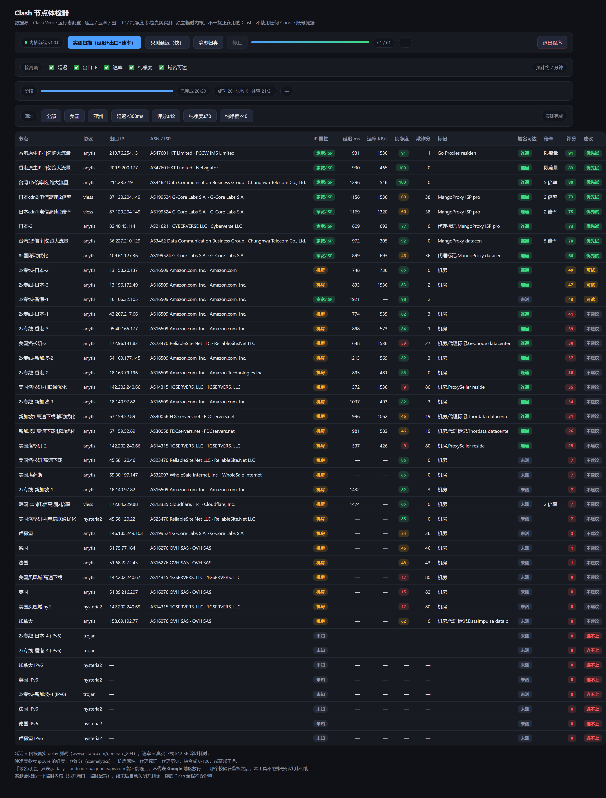
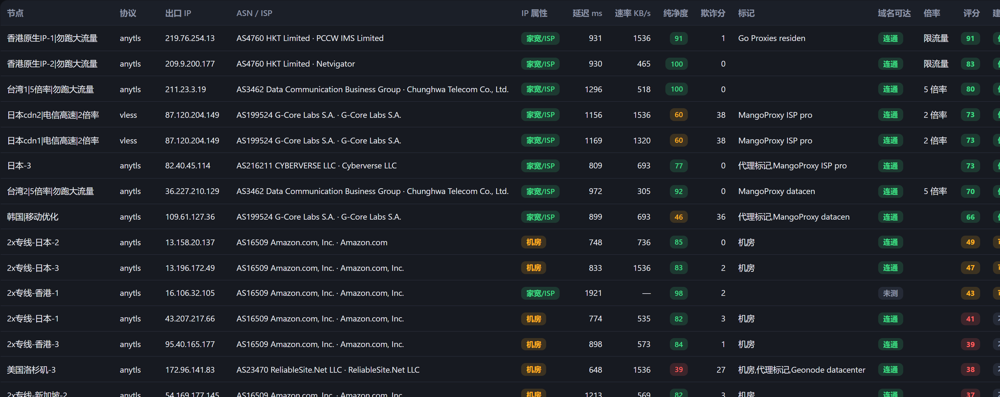
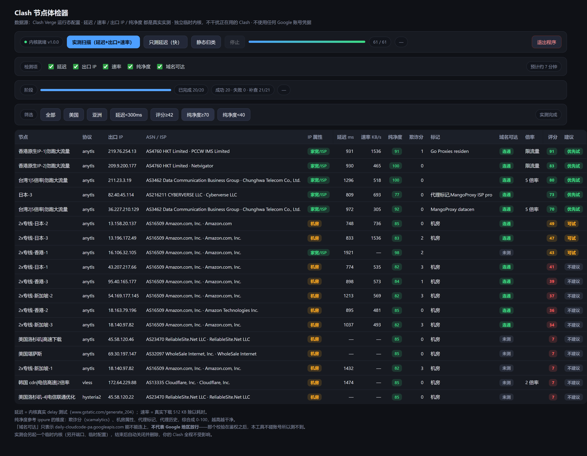
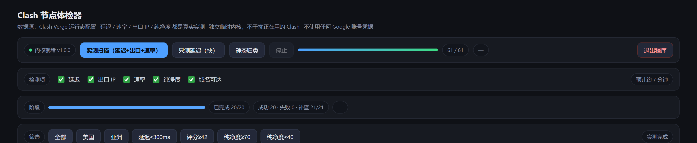
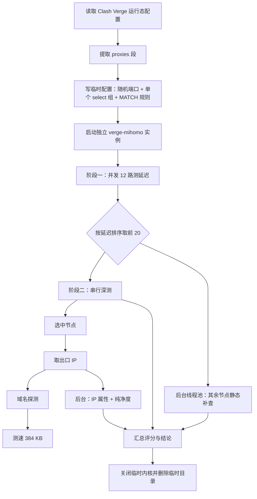

# Clash 节点体检器 · ClashCheckup

给 Clash 节点做一次**真实体检**：延迟、速率、出口 IP、IP 纯净度全部实测，不是按 IP 属性猜的。

面向的场景很具体——机场节点几十个，你想知道哪些真的能跑，尤其想知道哪些 IP 是干净的（没被当住宅代理转卖过），因为很多服务会据此判断风险。



---

## 目录

- [特性](#特性)
- [截图](#截图)
- [它测什么、不测什么](#它测什么不测什么)
- [快速开始](#快速开始)
- [工作原理](#工作原理)
- [检测项与耗时](#检测项与耗时)
- [纯净度算法](#纯净度算法)
- [评分与排序](#评分与排序)
- [性能：并发调度](#性能并发调度)
- [项目结构](#项目结构)
- [开发与打包](#开发与打包)
- [已知限制](#已知限制)
- [更新日志](#更新日志)

---

## 特性

- **真实延迟**：调 mihomo 内核的 delay 接口，目标是 `www.gstatic.com/generate_204`
- **真实速率**：真的下载 384 KB 数据，按首字节之后的时间算速率
- **真实出口 IP**：真的从该节点出去，看外部世界看到的是哪个 IP
- **IP 纯净度 0-100**：参考 [ippure](https://ippure.com/) 的维度自建，综合欺诈分、机房属性、代理标记、代理历史
- **不干扰正在用的 Clash**：另起一个临时 mihomo 实例、另开端口、另写配置，测完即删
- **不碰任何账号**：全程不登录、不带凭据，不会被服务商标记
- **检测项可勾选**：只要延迟就只测延迟，十几秒出结果
- **原生桌面窗口**：WinForms + WebView2 内嵌，不是浏览器标签页

## 截图

**完整结果表**（按评分排序，不可用节点自动沉底）：



**只看纯净的节点**（点「纯净度≥70」筛选）：



**顶部控制区**：检测项勾选、总进度、阶段进度、剩余时间、成功/失败计数。



## 它测什么、不测什么

| 指标 | 怎么来的 | 真实性 |
|---|---|---|
| 延迟 | 临时内核的 delay 测试（gstatic generate_204） | 真实 |
| 速率 | 真实下载 384 KB ÷ 耗时 | 真实 |
| 出口 IP | 从该节点出去后看到的公网 IP | 真实 |
| IP 属性 | ip-api：是否机房、是否被标记代理 | 真实 |
| 纯净度 | 欺诈分 + 机房 + 代理标记 + 代理历史 | 真实抓取、加权计算 |
| 域名可达 | 能不能连上 `daily-cloudcode-pa.googleapis.com` | 真实，但**含义有限** |

**明确测不到的东西**：Google 的「地区不支持」400。这个校验发生在**鉴权之后**——不带账号去请求只会拿到 401，所以任何不碰账号的工具都不可能直接测出 200/400。

所以「域名可达」这一列只代表「这个域名连不连得上」，**不代表地区放行**。

## 快速开始

### 方式一：直接下 exe（推荐）

1. 到 [Releases](../../releases) 下载 `ClashCheckup.exe`
2. 双击运行，会打开一个原生桌面窗口
3. 点「实测扫描」，等 3 分钟左右

**前提**：装了 Clash Verge（程序会自动找它自带的 `verge-mihomo.exe` 和运行态配置）。

命令行参数：

```
ClashCheckup.exe                # 原生窗口（默认）
ClashCheckup.exe --browser      # 用系统浏览器打开
ClashCheckup.exe --no-browser   # 只跑服务，不开界面
ClashCheckup.exe --port 9000    # 换端口
```

### 方式二：源码运行

```bash
git clone git@github.com:lylyuanliang/ag-node-scanner.git
cd ag-node-scanner
pip install pywebview
python -u agscanner.py
```

## 工作原理



**为什么不影响你正在用的 Clash**：临时实例有独立的 `mixed-port`、独立的 `external-controller`、独立的配置目录，规则只有一条 `MATCH,<临时组>`。你的 TUN、分流规则、当前选中节点全程不参与，也不会被改动。

## 检测项与耗时

界面里五个复选框，默认全选：

| 勾选项 | 关掉后省什么 | 实测单价 |
|---|---|---|
| 延迟 | 阶段一整段 | 约 12 秒 |
| 出口 IP | 每节点少一次出口查询 | 约 2-4 秒/节点 |
| 速率 | 不下载 384 KB | 约 3-8 秒/节点 |
| 纯净度 | 不抓 scamalytics | 约 3 秒/节点 |
| 域名可达 | 不探 Google 域名 | 约 1-2 秒/节点 |

联动规则：

- 勾了「纯净度」会自动带上「出口 IP」（纯净度需要真实出口）
- 不勾「延迟」时，深测对象改成配置里的前 20 个节点，不再按延迟排序
- 不深测的节点仍会做一次静态 ASN / 纯净度查询（同样受纯净度开关控制）
- 右侧「预计约 N 分钟」随勾选实时变化

实测参考：全选 41 个节点、深测 20 个，**约 197-210 秒**。

## 纯净度算法

参考 ippure 的四个维度，数据源换成可公开抓取的：

| 维度 | 来源 | 权重 |
|---|---|---|
| 欺诈分 0-100 | [scamalytics](https://scamalytics.com/) | 基础分 = 100 − 欺诈分 × 0.85 |
| 机房属性 | ip-api `hosting` | −15 |
| 代理标记 | ip-api `proxy` | −15 |
| 代理历史 | scamalytics `Last Proxy Provider` | −8，并显示代理商名 |

公式：

```
纯净度 = clamp(100 − 欺诈分×0.85 − 机房15 − 代理15 − 代理历史8, 0, 100)
```

**为什么「代理历史」重要**：机场的「原生 IP」经常被当住宅代理转卖过。实测例子：

| 节点 | 纯净度 | 欺诈分 | 标记 |
|---|---|---|---|
| 台湾1 | 100 | 0 | — |
| 香港原生IP-2 | 100 | 0 | — |
| 香港原生IP-1 | 91 | 1 | Go Proxies residential |
| 美国洛杉矶-1 | 9 | 80 | 机房 + ProxySeller residential |

同样是「原生 IP」标签，被代理商转卖过的那个，纯净度直接掉到 91；被当住宅代理池的美国节点掉到 9。

## 评分与排序

| 项 | 分值 |
|---|---|
| 出口是家宽/ISP（非机房） | +34 |
| 未被标记为代理 | +6 |
| 纯净度 | 按 16 × 纯净度/100 加分，低于 30 再扣 6 |
| 域名可达 | +8 / 不可达 −8 |
| 速率 | 每 25 KB/s +1，上限 +28 |
| 延迟 | 越低越高，上限 +24 |
| ASN 命中已知机房名 | −12 |
| 节点带 5 倍率 | −4 |

结论：`优先试 ≥ 62 且速率 ≥ 150 KB/s`、`可试 ≥ 42`、其余 `不建议`。

**排序规则**：任何列排序时，**不可用节点（连不上 / 六项全空）永远沉底**，评分固定 0、结论「连不上」。

**评分不等于一定能用**。已知反例：同一机房（1Gservers 142.202.240.0/22）的两个 IP，一个能跑通、另一个返回 400。最终确认仍需手动发一条真实请求。

## 性能：并发调度

| 改动 | 说明 |
|---|---|
| 延迟阶段 12 并发 | 41 个节点的 delay 测试同时打，约 12 秒完成 |
| 静态补查后台化 | 21 个不深测的节点（DoH + ASN + 纯净度）与深测同时进行 |
| 属性/纯净度流水线化 | 拿到出口 IP 就丢给后台线程，主线程直接去测速 |
| 每个网络动作加墙钟上限 | 出口 6 秒、域名 5 秒、测速 8 秒，到点就断 |
| 测速按首字节后计时 | TLS 建连时间不算进速率 |

优化前后：**385 秒 → 197 秒**。

## 项目结构

```
ag-node-scanner/
├── agscanner.py                       # 全部逻辑（单文件，约 1100 行）
├── ClashCheckup.exe                   # 打包产物（不入库，见 Releases）
├── start.cmd                          # 双击启动脚本
├── docs/screenshots/                  # README 用截图
├── scripts/capture_screenshots.py     # 用 Playwright 重出截图
├── README.md
├── CHANGELOG.md
├── LICENSE
└── .gitignore
```

## 开发与打包

### 依赖

- Python 3.11+
- `pywebview`（原生窗口；不装也能跑，会自动退回浏览器）
- Clash Verge（提供 `verge-mihomo.exe` 与运行态配置）
- 打包还需 `pyinstaller`

### 打包（conda 环境注意事项）

conda 的 Python 打 exe 时必须手动补 DLL，否则 https 和原生窗口都会**静默失败**：

```bash
python -m PyInstaller --onefile --noconsole --name ClashCheckup \
  --collect-data certifi --collect-all webview --collect-all pythonnet --hidden-import clr \
  --hidden-import ssl --hidden-import _ssl \
  --add-binary "D:\soft\miniconda3\Library\bin\libssl-3-x64.dll;." \
  --add-binary "D:\soft\miniconda3\Library\bin\libcrypto-3-x64.dll;." \
  --add-binary "D:\soft\miniconda3\Library\bin\ffi.dll;." \
  --add-binary "%APPDATA%\Python\Python313\site-packages\pythonnet\runtime\Python.Runtime.dll;." \
  agscanner.py
```

几个踩过的坑：

| 缺什么 | 症状 |
|---|---|
| `libssl` / `libcrypto` | 延迟正常，但出口 IP、速率、纯净度全空（https 全挂） |
| `ffi.dll`（**不是** `ffi-8.dll`） | `import ctypes` 失败 → pywebview 起不来 → 程序悄悄退回浏览器 |
| `Python.Runtime.dll` | 原生窗口加载 pythonnet 失败 |

### 重新出截图

```bash
python agscanner.py --no-browser &
python scripts/capture_screenshots.py
```

## 已知限制

1. **只支持 Clash Verge**：读的是它固定路径下的运行态配置，内核也用它的 `verge-mihomo.exe`
2. **测不出服务端的地区限制**：见上文，校验在鉴权之后
3. **测速是抽样**：只测 384 KB，且被 8 秒墙钟截断时显示的是速率下限
4. **只深测前 20 个节点**：按延迟排序，避免白耗流量
5. **纯净度依赖第三方**：scamalytics 有 1.2 秒/次的软限速，ip-api 有 45 次/分钟的限制

## 更新日志

见 [CHANGELOG.md](CHANGELOG.md)。

## 许可

[MIT](LICENSE)

## 免责声明

本工具仅供学习交流使用，用于检测自己合法拥有的代理节点质量，不得用于商业用途或任何非法用途。

请遵守所在地区法律法规与所使用服务商的条款。使用本工具产生的一切后果由使用者自行承担，作者不承担任何责任。
